<!-- ============ ANIMATED HEADER ============ -->

 

 

<!-- ============ 3D ID CARD ============ -->

<!-- ============ ABOUT ============ -->
##  About Me

I'm a **Full Stack Developer** who turns ideas into polished, production-ready web products using the **MERN stack**. I enjoy building end to end: sleek UIs, solid APIs, and smart AI-powered features.

-  Currently building **HyperNova AI** and **Fizora Lab**
-  Always learning new tools and better ways to ship
-  I care about clean code, performance, and great UX
-  Open to collaborations, freelance work, and full-time roles

 

<!-- ============ TECH STACK ============ -->
##  Tech Stack

<table align="center">
<tr>
<td align="center"> <b>Frontend</b></td>
<td>

</td>
</tr>
<tr>
<td align="center"> <b>Backend</b></td>
<td>

</td>
</tr>
<tr>
<td align="center"> <b>Database</b></td>
<td>

</td>
</tr>
<tr>
<td align="center"> <b>Tools</b></td>
<td>

</td>
</tr>
</table>

<!-- ============ PROJECTS ============ -->
##  Top Projects

<table align="center">
<tr>
<td width="50%" valign="top">

###  HyperNova AI
An AI-powered web app that delivers smart, fast, and intuitive user experiences.

<!-- Add link: [View Project](https://github.com/Fizzaamin/hypernova-ai) -->

</td>
<td width="50%" valign="top">

###  Fizora Lab
A full stack project built around clean architecture, modern UI, and a scalable backend.

<!-- Add link: [View Project](https://github.com/Fizzaamin/fizora-lab) -->

</td>
</tr>
</table>

<!-- ============ STATS ============ -->
##  GitHub Stats

<!-- Replace Fizzaamin everywhere with the real GitHub username -->

<!-- ============ CONNECT ============ -->
##  Let's Connect

I'm always up for chatting about web development, AI projects, or new opportunities. Say hello!

  

 *If you like my work, drop a star or say hi!* 

